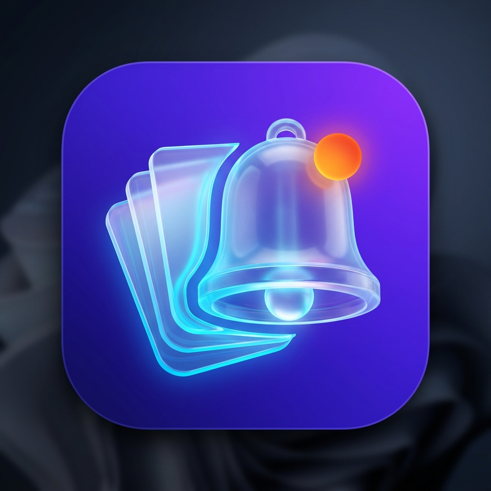

# 🔔 Smart Notify (`smart-notify`)

<p align="center">
  
</p>

<p align="center">
  <strong>Production-grade, ultra-lightweight Windows 11 Smart Notification Overlay</strong><br>
  Built with Tauri v2 (Rust + TypeScript/HTML/CSS), WinRT interception, and frosted-glass blur.
</p>

---

## ✨ Features

- 🪟 **Real Desktop Frosted-Glass Blur (Mica & Acrylic feel)**:
  - Windows 11 Fluent aesthetic (`backdrop-filter: blur(28px) saturate(190%)`).
  - Automatic system Dark & Light mode adaptation via `prefers-color-scheme`.
  - Borderless, transparent, non-focusable, click-through overlay window anchored to the top-right of the primary display (`width: 400`, `height: 680`, `x: screen_width - 416`, `y: 16`).
  - Dynamic DPI and display scaling recalculation.
- 🎯 **Seamless Click-Through Experience**:
  - The transparent canvas passes all mouse clicks straight through to underlying windows (`window.set_ignore_cursor_events(true)`).
  - Hovering over any notification card or the history drawer instantly activates pointer interaction (`set_ignore_cursor_events(false)`).
- ⚡ **Event-Driven WinRT Interception (Zero Polling)**:
  - Intercepts incoming Windows notifications natively via WinRT `UserNotificationListener` on a dedicated MTA thread.
  - Safely extracts `AppUserModelId`, display name, crisp high-res app icon (decoded via `DataReader` into base64 data URI), title, body lines from `KnownNotificationBindings::ToastGeneric`, and timestamps.
- 🧠 **Smart Notify Intelligence Layer (Rust Engine)**:
  1. **Fullscreen & Presentation Detection**: Queries `SHQueryUserNotificationState` (`Win32::UI::Shell`). Holds alerts silently in history if the user is in exclusive fullscreen games or presentation mode (`QUNS_BUSY`, `QUNS_RUNNING_D3D_FULL_SCREEN`, `QUNS_PRESENTATION_MODE`), unless tagged as urgent.
  2. **Burst Coalescing & Rate Limiting**: If an app fires 3+ alerts within 4 seconds (e.g. rapid WhatsApp, Discord, or Slack messages), they coalesce into an in-place summary card (`"3 new alerts from Slack"`) with previous messages previewed.
  3. **Stacked App Deck**: Groups incoming notifications by `app_id` into a physical card deck with 1–2 layered edges peeking underneath and a `+N more` badge. Clicking the deck smoothly fans out all cards; clicking again collapses it.
  4. **Keyword Priority & Accent Ring**: Matches urgent keywords (`OTP`, `verification`, `2fa`, `urgent`, `critical`, `build failed`, `security alert`). Extends banner timer to 9s and highlights with a glowing accent ring.
  5. **Mute Rules**: Auto-creates and monitors `%APPDATA%\smart-notify\smart-rules.json` to silently archive noisy apps without screen interruptions.
  6. **In-Memory Ring Buffer History (50 alerts)**: Slide-out Notification Center drawer (`Alt + Shift + N` or system tray icon click) to search, filter by app, review missed alerts, or clear history.
- 🍃 **Genuine Spring Physics & Gestures**:
  - Slide-in physics using `cubic-bezier(0.22, 1.12, 0.36, 1)`.
  - Smooth horizontal swipe-to-dismiss gesture (drag or flick right with mouse or trackpad).
  - Auto-dismiss countdown bar with pause-on-hover.
  - Floating circular top-left `×` dismiss button revealed on hover, plus a `"Clear All"` pill for multi-card stacks.
- 📦 **Windows App Identity (Sparse MSIX)**:
  - Automates sparse package identity registration with `AppxManifest.xml` and `register-identity.ps1`, granting full trust `userNotificationListener` capability to any standard Win32 binary.

---

## 🚀 Getting Started

### 1. Prerequisites
- **Windows 11 / Windows 10** (build 1809 or higher)
- **Rust Toolchain**: Install from [rustup.rs](https://rustup.rs/)
- **Node.js**: Install v18+ from [nodejs.org](https://nodejs.org/)
- **Windows SDK**: Ensure `makeappx.exe` and `signtool.exe` are installed (via Visual Studio Installer or Windows SDK).

### 2. Frontend Build
Compile TypeScript code and prepare `dist/`:
```powershell
npm run build
```

### 3. Build the Release Binary
```powershell
cargo build --release --manifest-path src-tauri/Cargo.toml
```

The compiled binary will be placed at:
`src-tauri\target\release\smart-notify.exe`

---

## 🔏 Windows Sparse MSIX Identity Setup

Windows 11 requires a package identity for `UserNotificationListener`. Run the automated setup script in PowerShell:
```powershell
powershell -ExecutionPolicy Bypass -File .\sparse-package\register-identity.ps1
```

---

## 🔕 Disabling Windows Native Banners

To prevent duplicate banners and allow Smart Notify to be your sole notification experience:
1. Open Windows Settings (`Win + I`).
2. Go to **System → Notifications**.
3. Under **Notifications**, set **Show notification banners** to **Off**.
4. Keep **Show notifications in notification center** set to **On**.

---

## 🎮 Shortcuts & Controls

| Action | Control |
|---|---|
| **Toggle History Drawer** | `Alt + Shift + N` or Left-Click System Tray Icon |
| **Close Drawer / Collapse Stacks** | `Escape` |
| **Dismiss Notification** | Hover and click `×` or swipe / flick card right |
| **Expand / Collapse App Stack** | Click top card of any multi-notification deck |
| **Clear All for an App** | Hover stack and click `"Clear All"` pill |
| **Pause Notifications (1 hr)** | Click Moon icon in drawer or right-click Tray → **Smart Focus Pause** |
| **Send Test Alert** | Tray menu → **Send Test Notification** or Play icon in Drawer |

---

## 📄 License
MIT License.
